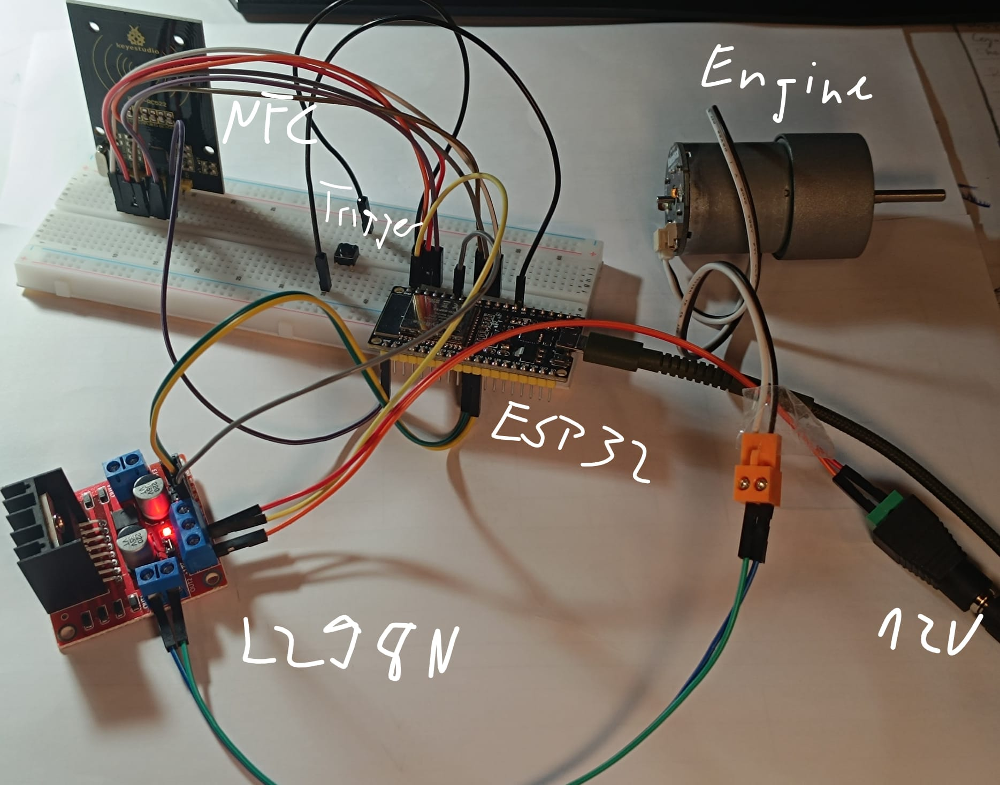

(Work in Progress)

Heyjo, this is a personal project of mine with the following goal:

A modular, smart DIY power tool based on the ESP32. The system is designed to automatically detect which tool head (e.g., drill bit, screwdriver...) has been attached via NFC tags (and possibly via pogo pins in the future), and dynamically adjusts the motor parameters (speed, direction of rotation, braking behavior) in real time or allows the user to specify the exact behavior.

## Features (at the moment)
*   **Plug & Play Tool Recognition:** The MFRC522 NFC reader reads tags in the tool head.
*   **Dynamic Motor Profiles:** Automatic adjustment of PWM speed (e.g., 100% for drilling, 50% for screwing).
*   **Active Braking:** An electronic motor brake (H-bridge short circuit) stops the tool immediately when the trigger is released.
*   **Safety Lockout:** Unknown tools (or missing NFC tags) completely block motor operation.

## Hardware (Parts List)
*   **Microcontroller:** ESP32 NodeMCU (3.3V Logic)
*   **Motor Driver:** L298N Dual H-Bridge
*   **Motor:** 12V/15V DC Motor (Makeblock)
*   **NFC Scanner:** MFRC522 (13.56 MHz)
*   **Tags:** NTAG215 stickers or standard Mifare 1K cards
*   **Miscellaneous:** Short-stroke pushbutton (trigger), 15V DC power supply, breadboard & jumper wires

## Pin Assignment (Wiring)

**Caution:** The ESP32 and the MFRC522 are strictly 3.3V components. Never apply 5V or the motor’s 15V to these pins! The ESP32 and the L298N must share a common ground (GND).

| Component             | Pin       | ESP32 Pin | Note                              |
|                       |           |           |                                   |
| **NFC (MFRC522)**     | NSS       | GPIO 5    |                                   |
|                       | SCK       | GPIO 18   | Hardware SPI                      |
|                       | MISO      | GPIO 19   | Hardware SPI                      |
|                       | MOSI      | GPIO 23   | Hardware SPI                      |
|                       | RST       | GPIO 22   |                                   |
|                       | VCC       | 3V3       | **NOT to 5V!**                    |
|                       | GND       | GND       | Shared ground                     |
| **Engine (L298N)**    | ENA       | GPIO 21   | PWM (speed)                       |
|                       | IN1       | GPIO 26   | Forward direction                 |
|                       | IN2       | GPIO 27   | Reverse direction                 |
|                       | 12V/VCC   | -         | Directly to 15V power supply (+)  |
|                       | GND       | GND       | Common ground (-)                 |
| **Trigger (Button)**  | Out 1     | GPIO 4    | Internal pull-up enabled          |
|                       | Out 2     | GND       | Switches to ground                |

## Software Setup (PlatformIO)
1. Clone the repository: `git clone https://github.com/ConQuen13/OmniDrive.git`
2. Open it in VS Code with the **PlatformIO** extension installed.
3. The required NFC library is automatically downloaded during the first build via the `platformio.ini` file (`lib_deps = miguelbalboa/MFRC522`).
4. Compile the code and flash it to the ESP32.

